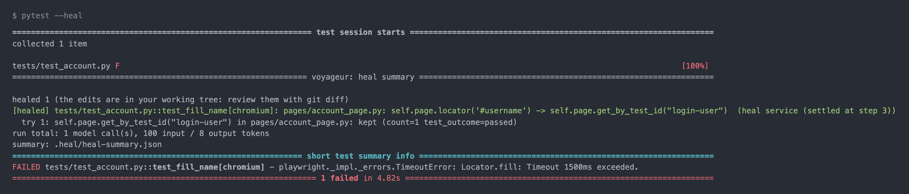
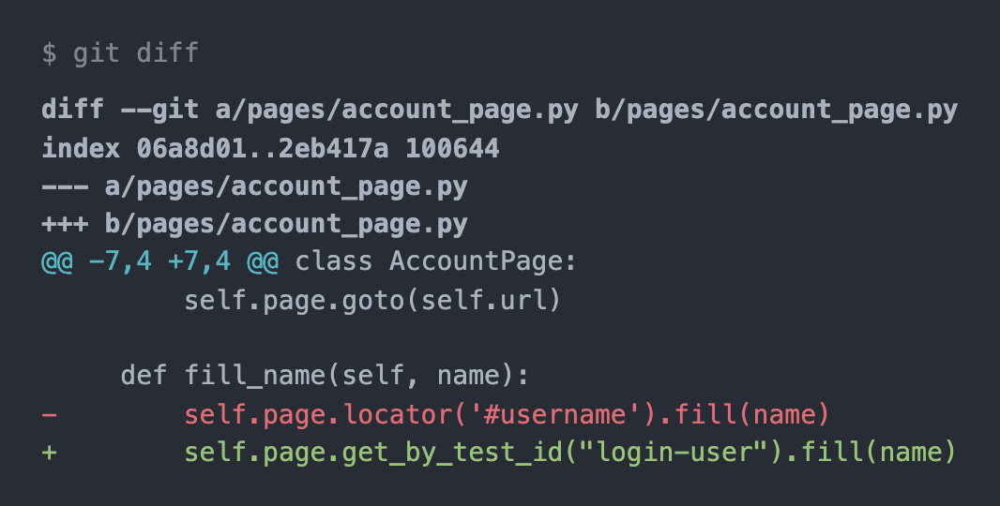

# pytest-voyageur

A pytest plugin that heals drifted Playwright locators. A test fails because an id was renamed or a label was reworded; the
plugin probes the page it failed on, asks a [Voyageur](https://github.com/philmcneely/voyageur) service which element the broken
step meant, applies the locator the service writes under strict client-side safety checks, re-runs the exact test and keeps the
edit only if the service confirms it. The edit stays in your working tree for you to review.

## Install

pytest-voyageur is not on PyPI. Install it from GitHub, next to pytest-playwright:

```bash
pip install "git+https://github.com/philmcneely/pytest-voyageur"
playwright install chromium        # if you have not already
```

It needs Python 3.10 or newer. pytest finds the plugin through its `pytest11` entry point, so there is nothing to import.

## Quick start

The plugin is the client. The healing is done by a [Voyageur](https://github.com/philmcneely/voyageur) service (see "The service" below).

```bash
voyageur serve                     # in another terminal: http://127.0.0.1:8765, loopback only, no token
pytest --heal                      # or VOYAGEUR_HEAL=1; your tests are unchanged
```

Without `--heal` the plugin does nothing: no hook acts, no Playwright class is touched, the service is never called.

## What a run looks like

This is a real run of `pytest --heal` in a small Playwright suite whose `#username` id was renamed. It was captured from the
terminal and rendered to an image. The service in this run answered from a scripted model instead of a real one, so the output
shows the plugin's behaviour, not the quality of any model. The suite, the browser, the service and the plugin are the real ones.



The edit is a plain change in your working tree:



The run that needed the heal still reports that test as **failed**: it did fail, against the code as it was. The next plain
`pytest` run passes (`1 passed`). A failure the service could not heal is listed under "needs a person" with its reason code
(`no_candidate_left`, `no_identity_proof`, `target_removed`, ...), and every try of every heal is printed, kept or reverted.

## How a heal goes

1. A test fails in its `call` phase. The plugin takes the test's own `page` (a menu still open, a tab still chosen), runs the
   vendored probe on it for an element inventory and an aria snapshot, and sends them with the source files of the failing stack.
   If the test has no usable page, a fresh Chromium is opened on `BASE_URL` / `--base-url` instead.
2. `POST /v1/heal`. The service answers with a candidate: a locator it wrote, and the patch to apply.
3. **Before any file is touched** the client checks the candidate in the live page: exactly one match, and that match is the
   element the service said it expects. Locator code is never `eval`'d; the expression is walked and only approved Playwright
   calls with literal arguments are built.
4. The patch is applied only if its base hash is the file's current hash, the file is one the client sent and sits under the
   source roots, the span holds exactly the expected text and is one expression of the file's syntax tree, and the replacement is
   one clean locator expression on the same receiver. Files are written in place, atomically, with their mode, never through a
   symlink, never outside a source root; a partial multi-file write is reverted.
5. The exact test is re-run in a fresh process (`HEAL_RUN=1`, the service token withheld). The edit is kept only if that test ran
   and passed **and** the service answers `healed`. Anything else is reverted byte for byte, and the result is reported to the
   service, which may offer the next candidate (at most 5 per heal, within 15 minutes).
6. A failure the client cannot handle (service down, browser error, disk error) ends that heal as `needs_human` with the reason.
   It never raises into a test run.

A page object shared by several tests is healed once: later failures that run through an already healed file are confirmed by
re-running them, not healed twice. One heal runs at a time per repository (a file lock), so `pytest -n 4` is safe.

## How it talks to the service

Plain HTTP and JSON, with `httpx`, to `HEAL_SERVICE_URL` (or `--heal-url`). Four endpoints are used:

| Call | When |
| --- | --- |
| `GET /v1/capabilities` | at the start, to see what the service offers |
| `POST /v1/heal` | a failure to heal: the source files, the error, the probe's inventory and the aria snapshot |
| `POST /v1/heals/{id}/result` | after each try, with what the client's checks and the re-run showed; the answer is `healed` or the next candidate |
| `POST /v1/audit` | the `voyageur.audit` fixture |

`GET /v1/probe.js` is called only with `HEAL_PROBE_FROM_SERVICE=1`, and the script is used only if its sha256 equals the vendored
copy. One request may take up to 200 seconds. If `HEAL_SERVICE_TOKEN` is set it goes out as a bearer token.

## What leaves your machine

To the service you configured, and only that: the source files named in the failing stack (and the test's own file), up to 20 files
of 256 KB; the error text (URL queries and fragments cut); a text-only inventory of the page (tags, roles, ids, test ids, visible
copy, boxes); the aria snapshot; the page path and language; and, if you record them, what each locator hit on the last green run.

Never sent: input values, cookies, storage state, screenshots, HTML. The inventory is cut to an allowlist of keys on the client
side whatever the probe or service says; the aria snapshot has the typed text of input lines removed, the text of every value the
page itself holds (inputs, textareas, selects, editable regions) scrubbed, and link queries cut. A bearer token is never sent over
`http://` to a host other than localhost unless `HEAL_ALLOW_INSECURE=1`. Run the service on localhost, or behind TLS.

Source files and error text are sent as they are: do not put secrets in test code or in assertion messages.

## Options and environment

| Switch | Meaning |
| --- | --- |
| `--heal`, `VOYAGEUR_HEAL` | heal on failure (the variable takes `1`, `true`, `on` or `yes`) |
| `--heal-url URL` | the service (default `HEAL_SERVICE_URL`, else `http://127.0.0.1:8765`) |
| `--heal-max N` | heal at most N failing tests per run (default 10); the rest are listed as `needs_human` |
| `--heal-record`, `HEAL_FINGERPRINTS=on` | record what each locator hits on green tests (below) |
| `@pytest.mark.no_heal` | never heal this test |

| Variable | Default | Meaning |
| --- | --- | --- |
| `HEAL_SERVICE_URL` | `http://127.0.0.1:8765` | the Voyageur service |
| `HEAL_SERVICE_TOKEN` | unset | bearer token, when the service needs one |
| `HEAL_SOURCE_ROOTS` | `pages,tests,utils` plus the top directory of every collected test | comma separated relative directories the client may send and edit; `.` is the whole repository (never `.git`, `.venv`, `site-packages`, `.heal`) |
| `HEAL_TEST_ID_ATTRIBUTE` | `data-testid` | your Playwright `testIdAttribute` |
| `BASE_URL` | `--base-url` / ini `base_url` | the app, used only to reopen a route when the test's page is gone |
| `HEAL_STORAGE_STATE` | unset | Playwright storage-state file for that reopened page (never sent) |
| `HEAL_ARTIFACTS_DIR` | `.heal` | where `heal-summary.json` goes |
| `HEAL_RERUN_TIMEOUT` | `300` | seconds one verification re-run may take before it is killed and counted as failed |
| `HEAL_TIME_BUDGET` | `900` | seconds one heal may run before it stops asking for another candidate |
| `HEAL_DIR` | `.heal` | cache directory, a relative path inside the repository |
| `HEAL_REPO` | unset | a name for the repository, sent as `run.repo` |
| `HEAL_PROBE_FROM_SERVICE` | unset | `1`: fetch the service's probe and use it only if its sha256 equals the vendored one |
| `HEAL_ALLOW_INSECURE` | unset | `1`: allow the token over plain http to a non-localhost host |
| `HEAL_VISION`, `HEAL_MASK` | `off` | accepted for compatibility; this client never sends a screenshot |
| `HEAL_FINGERPRINT_COPY` | `on` | `off`: store hashes of element copy, not the copy |
| `HEAL_FINGERPRINTS_COMMIT` | unset | `on`: allow `.heal/` to be committed (otherwise it holds a `*` `.gitignore`) |
| `HEAL_RUN` | set by the plugin | marks the verification re-run; healing and recording are off while it is set |

These are the names the Playwright AI framework's client used; they are kept so a project can move over without changing its CI.

## Record a green run (optional, saves model calls)

```bash
pytest --heal-record               # on a green run: .heal/fingerprints.json (git-ignored)
```

For every locator a clean green test acts on (click, fill, check, ...), the probe's description of the element is stored, keyed by
the source line. When that line later fails, the service looks for the same element on the drifted page and often settles the heal
with **no model call**. Element copy may hold personal data and is sent as `last_pass`; set `HEAL_FINGERPRINT_COPY=off` to store
hashes instead. A fingerprint is written only from a test that passed once, with no rerun, and is not marked flaky.

## The `voyageur` fixture

```python
def test_page_locators_are_stable(page, voyageur):
    page.goto("/account")
    rows = voyageur.audit(page)["locators"]          # no model call, no edit
    assert not [r for r in rows if r["status"] in ("missing", "ambiguous")]
```

`voyageur.audit(page, files=None)` ranks every locator call in the files (default: the test's own file) against the page.
`voyageur.heal(page, error)` heals a failure you caught yourself (an exception, a pytest `ExceptionInfo` or text) the way the plugin
does. Both work with or without `--heal`, against the service at `HEAL_SERVICE_URL`.

## Language branches

When the page is now in another language than the passing run, the service may write a locator per language. The client adds
`from pytest_voyageur.language import by_language` to the file and the code reads:

```python
by_language(self.page, {"en": self.page.get_by_label("Username"), "fr": self.page.get_by_label("Nom d'utilisateur")})
```

The helper returns the locator of the page's `<html lang>` and the first entry for any other language, so a run in a language
nobody healed for behaves as before. A file that already imports it from the Playwright AI framework's `utils.heal_locale` is fine.

## The service

The plugin is only the client. The service is [`voyageur`](https://github.com/philmcneely/voyageur): it triages the failure, finds the
same element again from the inventory, uses a model only to pick among listed candidates, and writes the locator itself.
Install and start it as its README says (`HEAL_TEXT_BASE_URL` / `HEAL_TEXT_MODEL` name your model endpoint). This client was built
against service commit `277f319`; `GET /v1/capabilities` shows what a running service offers.

## Limits to know about

- **Sync Playwright only** (pytest-playwright's `page`). An async page cannot be driven from a pytest hook, so the async API is
  not supported (untested).
- **One edit must make the whole test pass.** A test with two drifted locators is not kept after the first one is fixed: the
  re-run still fails on the second, so the first edit is reverted. Heal them one run at a time, or fix the second by hand.
  (The service's `failed_later` result, which would keep the first edit, is not implemented in this client yet.)
- **Python source only**: a file that is not valid Python, or a locator the plugin cannot prove to be one expression, is never edited.
- The probe runs in your page with requests to other origins blocked while it runs. A hostile page can still read its own DOM at any
  moment; the probe is the service's own script, vendored and hash-checked, never fetched and run. WebSockets are not intercepted
  by that block.
- The failing test is reported failed in the run that healed it (above).
- Tested with pytest 9.2 and Playwright 1.65, on Python 3.12 (everything) and 3.10 (the client's unit tests). Older pytest and
  Playwright versions are allowed by the package metadata but not tested.

## Troubleshooting

| What you see | Why, and what to do |
| --- | --- |
| Nothing happens on a failure | Healing is off. Pass `--heal` or set `VOYAGEUR_HEAL=1`. The header line `voyageur: healing on` shows it is on. |
| The header says `voyageur: --heal is on but ...; healing is off for this run`, and the run goes on as plain pytest | Start the service, or point `--heal-url` / `HEAL_SERVICE_URL` at it. A heal never fails a test run on its own. |
| `needs_human` with a reason code | The service or a client check said no. The code (`no_candidate_left`, `no_identity_proof`, `target_removed`, ...) is printed with every try, and listed in `.heal/heal-summary.json`. |
| The heal says `source files outside the source roots were not sent` | The failing file is outside the source roots. Set `HEAL_SOURCE_ROOTS` (`.` is the whole repository). |
| The edit was reverted | The re-run of that one test did not pass. A test with two drifted locators is reverted after the first fix (see "Limits"). |
| A token error over `http://` | The token is not sent over plain http to a host other than localhost. Use TLS, or set `HEAL_ALLOW_INSECURE=1` knowingly. |
| A re-run is killed | It ran longer than `HEAL_RERUN_TIMEOUT` (300 seconds). Raise it for slow suites. |
| Heals stop after N tests | `--heal-max` (default 10) applies. The rest are listed as `needs_human`. |

## Development

```bash
uv venv --python 3.12 && uv pip install -e ".[dev]"
python -m pytest -q -m "not browser"       # unit + contract tests, no browser (the service is the `voyageur` dev dependency)
python -m pytest -q -m browser             # end-to-end: real Chromium, the real service in process, a scripted model
```

The end-to-end tests run a tiny Playwright suite in a pytester child process against a local site, with the service in the test
process answering from a scripted model: no model endpoint, no network beyond 127.0.0.1. They skip cleanly without Chromium
(`playwright install chromium`) or without the service (it needs Python 3.12).

- `tests/contract/cases` is a copy of the service's contract fixtures (`SOURCE.md` names the commit). `test_replay.py` drives the
  client through every case against the real service.
- `src/pytest_voyageur/probe.js` is the service's page probe, vendored; `probe.sha256` records its hash and
  `tests/unit/test_probe.py` compares it with the service's `GET /v1/probe.js`. When the service changes its probe:
  `python scripts/sync_probe.py`, read the diff, commit both files.

## Licence

MIT, so the client can go into any test suite, closed or open. See `LICENSE`. The Voyageur service it talks to is
separate and stays AGPL-3.0-only, with a commercial licence on request. The vendored probe script,
`src/pytest_voyageur/probe.js`, is copied from the service. The service's own copy stays AGPL-3.0-only; the copyright holder
releases this vendored copy under MIT, as part of this package. See `NOTICE`.

See also `NOTICE`, `CHANGELOG.md`, `SECURITY.md` and `CONTRIBUTING.md`.
